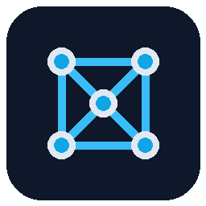

<p align="center">
  
</p>

# xtalforge

A pure Rust library for building, manipulating, analysing and exporting crystal
structures, with a CLI, Python bindings and WebAssembly bindings developed at
parity with the Rust API.

> Status: `1.7.0` published on 2026-11-13. Phases 0-14 are complete; Phase 15
> is next. The public API is frozen; later changes follow the SemVer policy in
> `docs/api/stability.md`. `1.7.0` adds the diffraction profile model,
> single-crystal factors, cell freedom and MD, slab bond carrying, undoable
> commands, OBJ/glTF meshes and HTML/JSON reports. The known reference gaps are
> listed in [`docs/roadmap/index.md`](docs/roadmap/index.md). The plan is in
> [`docs/roadmap`](docs/roadmap/index.md); the project rules are in
> [`AGENTS.md`](AGENTS.md).

## What works today

- Crystal structures: elements, lattices, sites, P1 expansion, supercells,
  slabs, transforms, periodic neighbours, bond graphs, rings and measures.
- Symmetry: space-group detection, Wyckoff positions, standard and primitive
  cells, lattice reduction, subgroups, layer and magnetic groups, molecular
  point groups, Brillouin zones and band paths.
- Formats and editing: CIF, mmCIF/PDBx, POSCAR, XYZ/extxyz, pymatgen JSON,
  CSSR, GEN, LAMMPS, SHELX, PDB, Quantum ESPRESSO, CASTEP, FHI-aims, CP2K,
  ABINIT, CRYSTAL, OUTCAR, vasprun.xml, MOL2 and SDF/MOL; atomic writes,
  project archives, undo/redo documents, selections, workspace runs and scene
  data.
- Force fields and thermodynamics: native UFF/UFF4MOF, QEq/EQeq/EEQ charges,
  Ewald, FIRE/L-BFGS, scans, Gamma-point vibrations, IR, thermochemistry and
  quasi-harmonic free energies.
- MOF platform: checker and solvent removal, deconstruction into nodes and
  linkers, RCSR topology, MOFid/MOFkey, open metal sites, native pore
  descriptors, UFF/EQeq-TraPPE adsorption, Widom/GCMC, PSM, defects,
  interpenetration, CoRE MOF/QMOF readers and screening.
- Core crystal features: structure matching and RMSD, strain and rattle,
  site editing and interpolation, Voronoi and coordination environments,
  bond-valence sums and oxidation states, RDF and fingerprints, unique Miller
  indices, slab terminations, Wulff shapes, adsorption sites, point defects,
  orderings and SQS, interfaces, elastic tensors, EOS fits and convex hulls.
- Analysis and builders: PXRD, porosity, isosurfaces, nets, RCSR matching,
  graphene, nanotubes, fullerenes, SMILES embedding, polymers, MOF assembly
  and powder refinement.
- Agent layer: session verbs, diagnostics, change bursts, SVG/PNG pictures,
  MCP over stdio and skill documents; open extension registries.
- Machine learning: the Python ASE bridge for MACE, ORB-v3 and MatterSim, with
  a checksum-verified model cache.
- Interoperability: ASE, pymatgen, phonopy/spglib and RDKit object adapters;
  OPTIMADE, COD and Materials Project fetching; Python entry-point plugins.
- Four surfaces at parity, with documented exceptions for the filesystem,
  subprocesses and threads in WASM. See `docs/api/parity.md`.

## Install

Install the current release:

```bash
cargo add xtalforge@1.7.0
pip install xtalforge==1.7.0
npm install xtalforge-wasm@1.7.0
```

## Goals

- Everything the headless core of [Crystal-Builder](https://github.com/JulesOpp/Crystal-Builder)
  does: symmetry-aware structure editing, file formats, force fields and
  optimizers, PXRD, porosity, topology, builders (molecules, carbons,
  polymers, MOFs) and powder refinement.
- Symmetry through [moyo](https://github.com/spglib/moyo).
- Proven code reused from [sci-form](https://github.com/jigonzalez930209/sci-form).
- Four surfaces at parity: Rust (`xtalforge` crate), CLI (`xtalforge`
  binary), Python (`xtalforge` on PyPI), WebAssembly (`xtalforge-wasm` on
  npm).
- Documentation site built with VitePress (`docs/`).

## Working on the project

```bash
scripts/check-rules.sh                 # 500-line limit and warning-suppression checks
cargo clippy --workspace --all-targets -- -D warnings
cd docs && npm install && npm run docs:dev
```

See [`docs/guide/contributing.md`](docs/guide/contributing.md) for the full
checklist and the roadmap workflow.

## License

Licensed under either of

- Apache License, Version 2.0 ([`LICENSE-APACHE`](LICENSE-APACHE))
- MIT license ([`LICENSE-MIT`](LICENSE-MIT))

at your option. Third-party code and data: `THIRD_PARTY.md`.
